# Projeto Architectural Kata — Project Sovereignty (Sysop Squad)

**Disciplina:** Arquitetura de Software | **Período:** 6º Período — Engenharia de Software  
**Professor:** Sidney Leandro da Silva | **Turma:** Segunda-feira | **Sprint:** Sprint 4 - Final do Projeto por Equipes

---

## Identificação da Equipe

| Nome do Integrante | Função na Sprint 4 | GitHub |
| :--- | :--- | :--- |
| **Eduardo Henrique** | Líder & Arquiteto Principal | `@eduardohenrique` |
| **Laura Martinson Vaz** | Pesquisadora DDD, Executora Core & QA / Fitness Functions | `@lmtsvaz` |
| **Eduardo Willian** | Pesquisador & Engenheiro de Resiliência, Integração & IA-Native | `@eduardowillian` |

---

## 1. Visão Geral do Sistema e Domínio de Negócio

### 1.1. Contexto do Projeto Selecionado
* **Architectural Kata:** 5. Sysop Squad (Suporte Técnico e Ticketing)
* **Desafio Principal de Engenharia:** Projetar e evoluir uma arquitetura distribuída de alta disponibilidade para triagem, diagnóstico e roteamento inteligente de chamados técnicos em lojas físicas distribuídas nacionalmente. O sistema precisa absorver picos severos de concorrência (como a Black Friday) sem indisponibilidade, combinando classificação semântica por **IA Multi-Agente**, cálculo de roteamento em tempo real baseado em três eixos dinâmicos (localização, matriz de habilidades e disponibilidade dos consultores) e integração resiliente com sistemas legados de inventário das lojas.

### 1.2. Resumo da Solução Proposta
O **Project Sovereignty** é uma arquitetura distribuída desenvolvida para o desafio **Sysop Squad**, projetada para gerenciar o ciclo de vida, a triagem inteligente e o roteamento em tempo real de chamados de suporte técnico em lojas físicas distribuídas nacionalmente. O sistema adota uma **Arquitetura Baseada em Serviços Orientada a Eventos**, separando responsabilidades entre o **TicketService** (*Core Domain*), o **RoutingEngine** (que calcula a atribuição ideal com base em localização, matriz de habilidades e carga horária dos consultores) e o **PresenceService** (monitoramento em tempo real via WebSockets e Redis).

Para sustentar alta disponibilidade e tolerância a falhas durante picos severos de acesso (como a Black Friday), o fluxo utiliza mensageria assíncrona (**RabbitMQ**) com *Retry Exponencial* e *Dead Letter Queue* (DLQ) para nivelamento de carga, além de **Degradação Graciosa** que chaveia o algoritmo para contingência *Round-Robin* regional em sobrecargas críticas. Estruturado sob os princípios **SOLID (DIP/OCP)** com distância da sequência principal $D = 0$, o núcleo incorpora o padrão **GoF State** no controle dos tickets, uma **Camada Anti-Corrupção (ACL)** com *Adapter* e *Circuit Breaker* para isolar o sistema legado de inventário, um pipeline **Multi-Agente de IA** com *Guardrails* (JSON Schema e anonimização de PII) e governança automatizada via testes **ArchUnit**.

---

## 2. Atributos de Qualidade e Matriz QAW

| Atributo de Qualidade | Cenário Padronizado (Fonte -> Estímulo -> Artefato -> Ambiente -> Resposta) | Medida da Resposta (Métrica Objetivo) |
| :--- | :--- | :--- |
| **Desempenho / Latência** | Gerentes de lojas e consultores enviam requisições concorrentes de abertura e atualização de tickets via SPA/Mobile sob carga normal de operação. | Latência **p95 < 250ms** na resposta de confirmação de criação e atualização de status. |
| **Disponibilidade / Resiliência** | O sistema legado de inventário (SOAP/XML) ou a API externa de LLM sofre queda ou *timeout* durante o horário comercial. | Isolamento via **Circuit Breaker** e ativação de **Fallback** (roteamento *Round-Robin* regional) sem indisponibilizar a abertura de chamados. |
| **Escalabilidade / Elasticidade** | Salto abrupto de acessos de 1.000 para 10.000 req/s durante evento pico (ex.: Black Friday). | Nivelamento de carga no **RabbitMQ** com zero perda de mensagens e subida automática de réplicas dos *workers* em **< 45 segundos**. |

---

## 3. Visão Geral da Arquitetura (Modelo C4)

A arquitetura está documentada conforme os três níveis de abstração do Modelo C4 na pasta `/docs/c4-model/`:
* 📄 **Nível 1 — Diagrama de Contexto:** [`docs/c4-model/c4-nivel-1-contexto.md`](docs/c4-model/c4-nivel-1-contexto.md)
* 📄 **Nível 2 — Diagrama de Contêineres:** [`docs/c4-model/c4-nivel-2-containers.md`](docs/c4-model/c4-nivel-2-containers.md)
* 📄 **Nível 3 — Diagrama de Componentes:** [`docs/c4-model/c4-nivel-3-componentes.md`](docs/c4-model/c4-nivel-3-componentes.md)

### Visualização do Diagrama de Contêineres (C4 - Nível 2)

```mermaid
C4Container
    title Diagrama de Contêineres (C4 - Nível 2) — Project Sovereignty (Sysop Squad)

    Person(gerente, "Gerente / Solicitante", "Abre chamados técnicos nas lojas físicas nacionais")
    Person(consultor, "Consultor Técnico", "Atende tickets e transmite localização/status em tempo real")

    System_Boundary(sysop_boundary, "Plataforma Sysop Squad (Project Sovereignty)") {
        Container(spa, "SPA / Mobile App", "React / PWA", "Interface responsiva para abertura e acompanhamento de chamados")
        Container(gateway, "API Gateway", "Kong / NGINX", "Ponto único de entrada, Rate Limiting, TLS e Autenticação JWT")
        
        Container(ticket_svc, "Ticket Service (Core)", "Java 21 / Spring Boot", "Gerencia ciclo de vida (GoF State) e isola legado via ACL")
        Container(presence_svc, "Presence Service", "Node.js + WebSocket", "Mantém status e geolocalização ativa dos consultores")
        Container(routing_engine, "Routing Engine", "Go / Python", "Calcula roteamento (Local + Skill + Carga) ou Fallback")
        Container(ai_worker, "AI Multi-Agent Worker", "Python + LangGraph", "Agentes de Classificação e Diagnóstico com Guardrails")
        
        Container(broker, "Message Broker", "RabbitMQ", "Filas assíncronas, Retry Exponencial e Dead Letter Queue (DLQ)")
        ContainerDb(db, "Banco de Dados Principal", "PostgreSQL", "Persistência transacional de tickets, histórico e skills")
        ContainerDb(cache, "Cache & Geo-Index", "Redis Cluster", "Cache em memória de presença em tempo real e habilidades")
        ContainerDb(vector_db, "Base de Conhecimento Vetorial", "Qdrant", "Embeddings de manuais técnicos e históricos para RAG")
    }

    System_Ext(legacy_inv, "Sistema Legado de Inventário", "Mainframe / SOAP-XML", "Base corporativa de ativos e hardware das lojas")
    System_Ext(llm_provider, "Provedor LLM", "API Cloud", "Inferência semântica para classificação e diagnóstico")

    Rel(gerente, spa, "Abre e consulta tickets", "HTTPS")
    Rel(consultor, spa, "Atualiza atendimento e telemetria", "WSS / HTTPS")
    Rel(spa, gateway, "Envia requisições", "JSON/HTTPS")
    
    Rel(gateway, ticket_svc, "Roteia comandos/consultas", "REST/JSON")
    Rel(gateway, presence_svc, "Estabelece canal bidirecional", "WebSocket")

    Rel(ticket_svc, db, "Lê e persiste chamados", "JDBC/TCP")
    Rel(ticket_svc, broker, "Publica TicketCriadoEvent", "AMQP")
    Rel(ticket_svc, legacy_inv, "Consulta ativo via ACL (Adapter + Circuit Breaker)", "SOAP/XML")

    Rel(broker, ai_worker, "Consome para triagem (c/ Retry e DLQ)", "AMQP")
    Rel(ai_worker, vector_db, "Consulta soluções similares (RAG)", "gRPC")
    Rel(ai_worker, llm_provider, "Executa inferência (PII sanitizado)", "HTTPS/JSON")
    Rel(ai_worker, broker, "Publica TicketClassificadoEvent", "AMQP")

    Rel(broker, routing_engine, "Consome ticket classificado", "AMQP")
    Rel(routing_engine, cache, "Lê geolocalização e disponibilidade", "Redis Protocol")
    Rel(presence_svc, cache, "Grava telemetria em tempo real", "Redis Protocol")
    Rel(routing_engine, ticket_svc, "Atribui consultor selecionado", "REST/gRPC")
```

---

## 4. Domain-Driven Design (DDD) & Limites de Contexto

* **Documentação Completa:** [`docs/ddd-context-map.md`](docs/ddd-context-map.md)

### 4.1. Classificação dos Subdomínios
* **Core Domain (Domínio Principal):** Gestão do Ciclo de Vida de Chamados (`TicketService`) e Motor de Roteamento Inteligente Multivariável (`RoutingEngine`).
* **Supporting Subdomain (Suporte):** Rastreamento de Presença e Localização em Tempo Real (`PresenceService`) e Pipeline de Triagem Inteligente por IA Multi-Agente (`AiTriageWorker`).
* **Generic Subdomain (Genérico):** Autenticação/Autorização (SSO/JWT via API Gateway) e Consulta ao Cadastro Legado de Ativos.

### 4.2. Mapa de Contexto e Camada Anti-Corrupção (ACL)
O contexto delimitado de **Gestão de Chamados (`TicketService`)** comunica-se com o **Sistema Legado de Inventário** por meio de uma **Anti-Corruption Layer (ACL)** implementada em `src/ticket-service/src/main/java/com/sovereignty/sysop/infrastructure/acl/LegacyInventoryAdapter.java`. Essa camada traduz esquemas XML legados para o *Value Object* limpo `AssetInfo` da Linguagem Ubíqua do núcleo.

---

## 5. Padrões de Projeto & Princípios SOLID

### 5.1. Princípios SOLID Aplicados e Auditoria de Métricas
* **Dependency Inversion Principle (DIP):** O domínio declara as interfaces de portas (`ITicketRepository`, `ILegacyInventoryService`, `IRoutingStrategy`), enquanto a infraestrutura fornece as implementações concretas. Na auditoria estrutural realizada na Sprint 2, a introdução dessas interfaces corrigiu o acoplamento direto entre `TicketService`, `RoutingEngine` e `PresenceService`, posicionando os três pacotes exatamente sobre a Sequência Principal ($D = |A + I - 1| = 0,00$).
* **Open/Closed Principle (OCP):** Novos estados no fluxo do chamado ou novas estratégias de roteamento em contingência são adicionados criando novas classes concretas que implementam as interfaces do domínio, sem modificar o código existente.

### 5.2. Catálogo de Padrões GoF Utilizados

| Padrão GoF | Categoria | Localização no Código | Problema de Engenharia Resolvido |
| :--- | :--- | :--- | :--- |
| **State** | Comportamental | `src/ticket-service/.../domain/states/` | Encapsula as regras de transição do ciclo de vida do chamado (`Aberto` -> `EmTriagemIA` -> `AguardandoConsultor` -> `EmAtendimento` -> `Resolvido` / `Contingencia`), eliminando blocos condicionais `if/else` complexos. |
| **Strategy** | Comportamental | `routing-engine/strategies/` | Alterna dinamicamente em tempo de execução entre o algoritmo multivariável completo (Localização + Habilidade + Carga) e o modo de Degradação Graciosa (*Round-Robin* por loja/região). |
| **Adapter** | Estrutural | `src/ticket-service/.../infrastructure/acl/` | Converte respostas XML/SOAP do sistema legado de inventário para o *Value Object* `AssetInfo` do domínio. |
| **Factory Method** | Criacional | `application/factories/` | Instancia dinamicamente a estratégia de roteamento adequada com base na telemetria de carga da fila RabbitMQ. |

---

## 6. Resiliência, Integração e IA-Native

### 6.1. Padrões de Resiliência Aplicados
* **Circuit Breaker, Timeout & Retry (Resilience4j):** Aplicado nas chamadas síncronas da ACL ao inventário legado. Caso a taxa de falhas ultrapasse 50% ou ocorra *timeout* (> 2s), o circuito abre e aciona o método de *Fallback*, registrando o ticket sem travar a interface do gerente.
* **Pipeline RabbitMQ (Load Leveling, Retry Exponencial e DLQ):** As filas absorvem picos de acesso. Falhas transitórias de processamento são encaminhadas para fila de espera com TTL progressivo (*backoff* exponencial: 2s, 4s, 8s). Após 3 falhas consecutivas, a mensagem envenenada (*Poison Pill*) é desviada para a *Dead Letter Queue* (`tickets.triage.dlq`).
* **Degradação Graciosa:** Quando o tamanho da fila excede o limiar crítico de operação, o sistema desativa temporariamente o cálculo geográfico complexo e chaveia para o roteamento regional simples.

### 6.2. Componente de Inteligência Artificial Generativa
* **Arquitetura AI-Native (Multi-Agentes):** Pipeline composto por **Agente Classificador** (define categoria, severidade e *skills*) e **Agente Diagnosticador (RAG)** (consulta base vetorial **Qdrant** com manuais históricos).
* **Guardrails & Segurança:** Middleware mascara dados pessoais identificáveis (CPF, e-mail, telefone — PII) antes do envio ao LLM, e a resposta é validada contra um **JSON Schema estrito**.

---

## 7. Registros de Decisões Arquiteturais (ADRs)

| ADR | Título da Decisão Arquitetural | Status | Data |
| :--- | :--- | :--- | :--- |
| [**ADR-001**](adrs/ADR-001-estilo-arquitetural.md) | Adoção de Arquitetura Baseada em Serviços Orientada a Eventos | Aprovado | 2026-09-10 |
| [**ADR-002**](adrs/ADR-002-desacoplamento-dip-gof.md) | Desacoplamento de Núcleo com DIP ($D=0$) e Padrões GoF (State/Strategy) | Aprovado | 2026-10-05 |
| [**ADR-003**](adrs/ADR-003-protocolos-mensageria-dlq.md) | Definição dos Protocolos de Integração (REST, WebSocket e RabbitMQ com Retry/DLQ) | Aprovado | 2026-10-20 |
| [**ADR-004**](adrs/ADR-004-bounded-contexts-acl.md) | Mapeamento de Contextos Delimitados e Camada Anti-Corrupção (ACL) | Aprovado | 2026-10-28 |
| [**ADR-005**](adrs/ADR-005-stack-gateway-vetorial.md) | Seleção de Frameworks, Banco Vetorial (Qdrant) e Stack do API Gateway | Aprovado | 2026-11-05 |
| [**ADR-006**](adrs/ADR-006-multi-agentes-guardrails.md) | Integração de Ecossistema Multi-Agente de IA e Guardrails de Segurança | Aprovado | 2026-11-15 |

---

## 8. Testes & Fitness Functions (Governança Automatizada)

### 8.1. Execução das Fitness Functions (ArchUnit)
A governança arquitetural é verificada automaticamente via `mvn test` utilizando **ArchUnit**:
* **Regra Validada 1 (Isolamento Estrito do Domínio):** Classes no pacote `..domain..` não possuem nenhuma dependência para `..infrastructure..`, frameworks web (`org.springframework..`), mensageria (`amqp`) ou bibliotecas de resiliência.
* **Regra Validada 2 (Inversão de Dependência — DIP):** Todas as classes concretas de adaptadores e repositórios em `..infrastructure..` implementam obrigatoriamente uma interface definida em `..domain.ports..`.
* **Regra Validada 3 (Conformidade GoF State):** Todas as classes no pacote `..domain.states..` implementam a interface `TicketState` e possuem o sufixo `State`.
