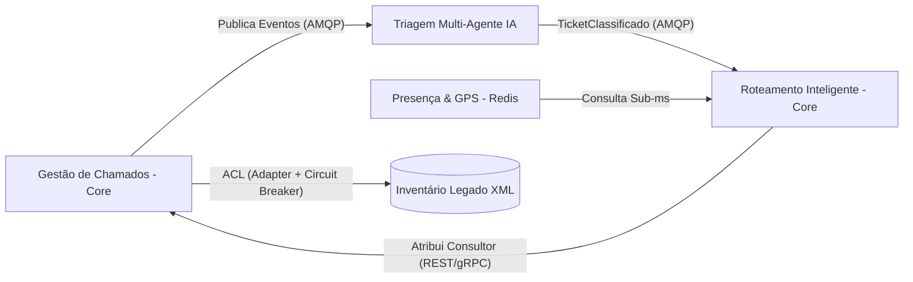

# Mapa de Contexto (DDD) & Linguagem Ubíqua — Sysop Squad

## 1. Contextos Delimitados (Bounded Contexts)
1. **Contexto de Gestão de Chamados (Core Domain):** Gerencia o agregado `Ticket`, seus estados (`TicketState`) e o vínculo com o ativo reportado (`AssetInfo`).
2. **Contexto de Roteamento Inteligente (Core Domain):** Calcula o melhor consultor cruzando proximidade geográfica, matriz de habilidades (`SkillMatrix`) e carga atual, ou aciona contingência *Round-Robin*.
3. **Contexto de Presença & Telemetria (Supporting):** Mantém em tempo real o status online/ocupado e coordenadas GPS dos consultores via WebSockets e Redis.
4. **Contexto de Triagem Cognitiva IA (Supporting):** Orquestra agentes de classificação e diagnóstico RAG sobre base vetorial.
5. **Contexto de Inventário Legado (Generic / Sistema Externo):** Mainframe corporativo acessado exclusivamente via **Anti-Corruption Layer (ACL)**.

## 2. Mapa de Relacionamento entre Contextos

