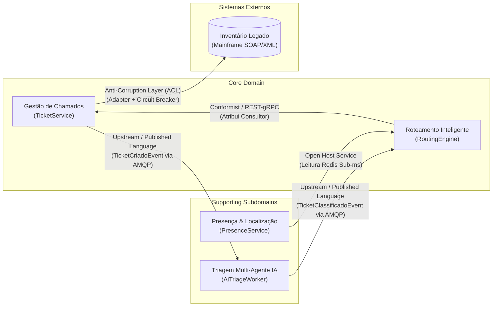

# Mapa de Contexto (DDD) & Linguagem Ubíqua — Project Sovereignty (Sysop Squad)

## 1. Contextos Delimitados (Bounded Contexts)

1. **Contexto de Gestão de Chamados (`TicketService` — Core Domain):** Gerencia o ciclo de vida completo da entidade agregada `Ticket` (via padrão GoF State), suas regras de transição e o vínculo com o equipamento defeituoso (`AssetInfo`).
2. **Contexto de Roteamento Inteligente (`RoutingEngine` — Core Domain):** Calcula a atribuição ideal do consultor cruzando três eixos dinâmicos (localização geográfica, matriz de habilidades e disponibilidade/carga horária), além de acionar o roteamento de contingência *Round-Robin* sob sobrecarga.
3. **Contexto de Presença & Telemetria (`PresenceService` — Supporting Subdomain):** Mantém em tempo real o status operacional (disponível, em atendimento, offline) e as coordenadas de localização dos consultores ativos via WebSockets e Redis Cluster.
4. **Contexto de Triagem Cognitiva (`AiTriageWorker` — Supporting Subdomain):** Orquestra os agentes de IA (Classificador e Diagnosticador com RAG em banco vetorial) com sanitização de PII e validação via JSON Schema.
5. **Contexto de Inventário Legado (Sistema Externo — Generic):** Mainframe corporativo que armazena o cadastro de patrimônio e garantia das lojas físicas em formato SOAP/XML, isolado por uma **Camada Anti-Corrupção (ACL)**.

---

## 2. Mapa de Relacionamento entre Contextos (Context Map)

---

## 3. Glossário da Linguagem Ubíqua (Ubiquitous Language)

| Termo de Negócio | Contexto | Definição no Domínio |
| :--- | :--- | :--- |
| **Ticket (Chamado)** | Gestão de Chamados | Solicitação formal de suporte técnico aberta por um gerente de loja, vinculada a um ativo e controlada por estados rígidos (`Aberto`, `EmTriagemIA`, `AguardandoConsultor`, `EmAtendimento`, `Contingencia`, `Resolvido`). |
| **AssetInfo (Ativo)** | Gestão de Chamados / ACL | *Value Object* limpo que representa o equipamento físico da loja (código de patrimônio, modelo e status de garantia), traduzido a partir do XML legado pela ACL. |
| **SkillMatrix (Matriz de Habilidades)** | Roteamento Inteligente | Conjunto de competências técnicas certificadas de cada consultor (ex.: `MANUTENCAO_PDV`, `INFRA_REDES`), cruzado com a categoria diagnosticada no chamado. |
| **Telemetria de Presença** | Presença & Localização | Sinal contínuo enviado pelo dispositivo do consultor contendo geolocalização e disponibilidade instantânea. |
| **Degradação Graciosa (Contingência)** | Roteamento Inteligente | Modo operacional de resiliência ativado automaticamente em picos críticos de fila, substituindo o cálculo geográfico multivariável pela distribuição *Round-Robin* regional. |
